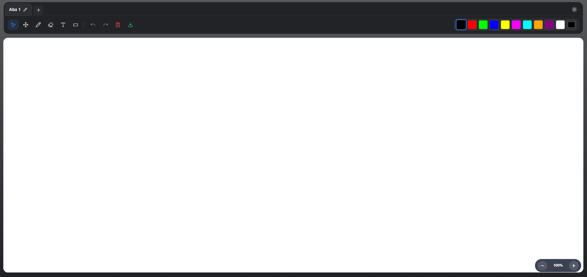

<h1 align="center">draw-tx</h1>

<br>

<br>

Editor de desenho e texto em navegador, construído com Next.js e React. A aplicação permite desenhar à mão livre, inserir texto, apagar partes do desenho, desfazer/refazer ações e exportar a arte final em PNG.

## Funcionalidades

- Caneta para desenhar livremente
- Borracha para remover traços
- Inserção de texto em qualquer ponto do canvas
- Ajuste de espessura da linha ou tamanho do texto
- Seleção de cores personalizadas e presets
- Desfazer e refazer ações
- Limpeza do canvas
- Download da imagem em formato PNG

## Tecnologias

- Next.js 16
- React 19
- Lucide React
- Canvas HTML

## Pré-requisitos

Antes de iniciar, certifique-se de ter instalado:

- Node.js 18+
- npm

## Instalação

```bash
npm install
```

## Executando o projeto

```bash
npm run dev
```

Acesse http://localhost:3000 para visualizar a aplicação.


## Como usar

1. Abra a aplicação no navegador.
2. Selecione a ferramenta desejada na barra superior.
3. Para desenhar, use a caneta.
4. Para inserir texto, escolha a opção de texto e clique no canvas.
5. Digite o texto e pressione Enter para confirmar, ou Esc para cancelar.
6. Use os botões de desfazer/refazer para ajustar o desenho.
7. Clique no botão de download para salvar a imagem.

